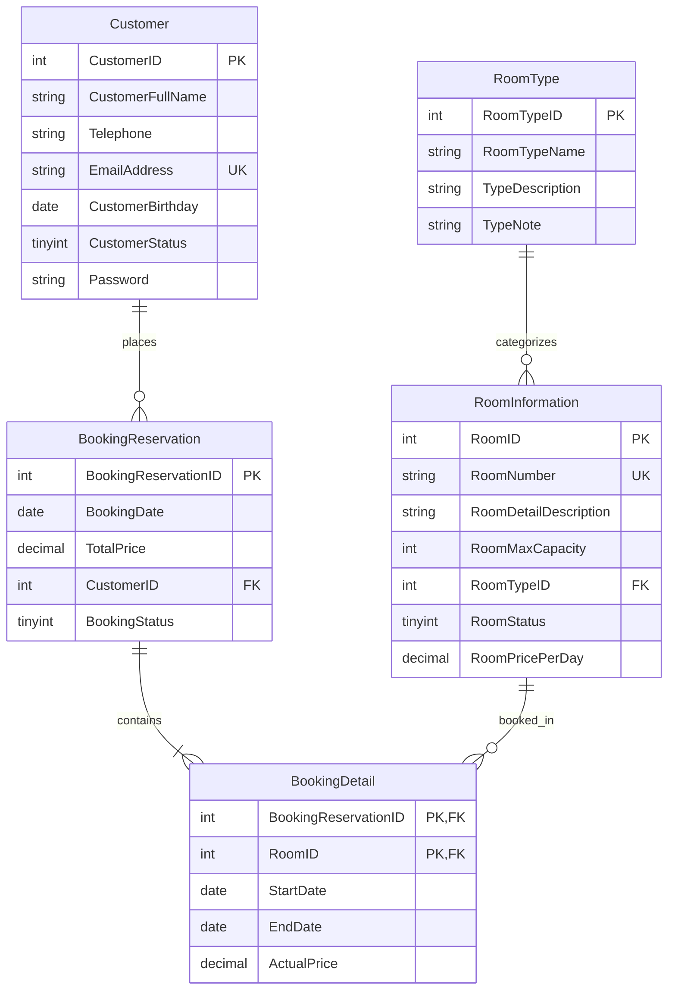

# FUMiniHotelSystem – Hotel Management System

**Project Name:** `A3OanhTP_SE1910`  
**Course:** SBA301 – Securing REST Services with Spring Boot  
**Assignment:** Assignment 03  
**Architecture:** 3-Layer Architecture with Repository Pattern & JWT Security  

---

## 1. Giới thiệu Project

**FUMiniHotelSystem** là giải pháp phần mềm quản lý khách sạn Full-stack chuyên nghiệp, hiện đại, đáp ứng tiêu chuẩn kiến trúc phần mềm doanh nghiệp:
- Cung cấp dịch vụ xem và tìm kiếm phòng khách sạn công khai không cần đăng nhập.
- Khách hàng (**Customer**) có thể đăng ký tài khoản cá nhân, quản lý hồ sơ cá nhân, đặt một hoặc nhiều phòng khách sạn cùng lúc trực tuyến và theo dõi lịch sử đặt phòng của chính mình.
- Nhân viên quản trị (**Staff**) có giao diện quản lý chuyên biệt: bảng điều khiển thống kê (Dashboard), quản lý danh sách khách hàng, quản lý danh mục phòng và giá, quản lý toàn bộ các đơn đặt phòng, thay đổi trạng thái đặt phòng hoặc đặt phòng thay cho khách hàng.
- Toàn bộ các API được bảo mật chặt chẽ bằng **Spring Security** kết hợp **JSON Web Token (JWT)** và mã hóa mật khẩu **BCrypt**.

---

## 2. Technology Stack

### Backend
- **Ngôn ngữ:** Java 21 (LTS).
- **Framework:** Spring Boot 3.3.5 (Spring Web, Spring Data JPA, Hibernate, Spring Security, Jakarta Bean Validation).
- **Bảo mật:** Spring Security 6.x, JWT (`io.jsonwebtoken:jjwt:0.12.6`), BCrypt Password Encoder.
- **Cơ sở dữ liệu:** Microsoft SQL Server 2016+ (Driver: `com.microsoft.sqlserver:mssql-jdbc`).
- **Build tool:** Apache Maven 3.9+.

### Frontend
- **Thư viện chính:** ReactJS 18+.
- **Build Tool:** Vite.
- **Ngôn ngữ:** JavaScript (ES6+).
- **Routing:** React Router DOM v6.
- **HTTP Client:** Axios với Request/Response Interceptors tập trung.
- **UI Framework:** Bootstrap 5 & Bootstrap Icons.

### Database
- **Hệ quản trị CSDL:** Microsoft SQL Server.
- **Tên CSDL:** `A3OanhTP_SE1910`.

---

## 3. Cấu trúc Project

```text
A3OanhTP_SE1910/
│
├── backend/
│   ├── pom.xml
│   └── src/
│       ├── main/
│       │   ├── java/com/oanhtp/fuminihotel/
│       │   │   ├── config/              # DataInitializer, cấu hình hệ thống
│       │   │   ├── controller/          # REST API Controllers (3-Layer)
│       │   │   ├── dto/
│       │   │   │   ├── request/         # Input DTOs với Bean Validation
│       │   │   │   └── response/        # Output DTOs an toàn (không lộ Password)
│       │   │   ├── entity/              # 5 JPA Entities & Composite PK
│       │   │   ├── exception/           # Global Exception Handling & Custom Exceptions
│       │   │   ├── repository/          # JpaRepository Interfaces & Custom Queries
│       │   │   ├── security/            # JWT Service, Filters, SecurityConfig, UserPrincipal
│       │   │   ├── service/             # Service Interfaces
│       │   │   │   └── impl/            # Business Service Implementations
│       │   │   └── FUMiniHotelApplication.java
│       │   └── resources/
│       │       └── application.properties
│       └── test/                        # Unit & Integration Tests (JUnit 5, Mockito)
│
├── frontend/
│   ├── package.json
│   ├── vite.config.js
│   ├── .env
│   ├── .env.example
│   ├── index.html
│   └── src/
│       ├── api/                         # Axios client, authApi, roomApi, customerApi, bookingApi
│       ├── components/
│       │   ├── common/                  # Reusable AlertMessage, ConfirmModal
│       │   └── layout/                  # Navbar, Footer, MainLayout, StaffLayout (Sidebar)
│       ├── contexts/                    # AuthContext (State JWT, User, Login, Logout)
│       ├── pages/
│       │   ├── auth/                    # Login, Register
│       │   ├── customer/                # RoomList, RoomDetail, CreateBooking, BookingHistory, Profile
│       │   └── staff/                   # Dashboard, CustomerManagement, RoomManagement, BookingManagement
│       ├── routes/                      # ProtectedRoute, RoleBasedRoute
│       ├── App.jsx                      # Router configuration
│       └── main.jsx
│
├── database/
│   ├── schema.sql                       # DDL Script tạo CSDL và 5 bảng, PK, FK, Constraints
│   ├── data.sql                         # Seed data mẫu
│   └── A3OanhTP_SE1910_Postman_Collection.json # Postman Collection 12 kịch bản test
│
├── PROGRESS.md                          # Nhật ký tiến trình chi tiết
└── README.md                            # Tài liệu hướng dẫn sử dụng và kiểm thử
```

---

## 4. Thiết kế Database

Hệ thống triển khai chính xác 5 Entity theo sơ đồ đề bài Assignment 03 (trang 4):



### Các ràng buộc cốt lõi
1. **Customer**:
   - `EmailAddress` là duy nhất (`UNIQUE`).
   - `Password` được mã hóa BCrypt trước khi lưu.
   - Không bao giờ trả về trường `password` trong bất kỳ API Response nào.
2. **RoomInformation**:
   - `RoomNumber` là duy nhất (`UNIQUE`).
   - `RoomMaxCapacity > 0` và `RoomPricePerDay > 0`.
   - Tham chiếu đến `RoomType` hợp lệ.
3. **BookingDetail**:
   - Khóa chính tổng hợp (Composite Primary Key): `(BookingReservationID, RoomID)`.
   - Triển khai chuẩn JPA bằng `@Embeddable` (`BookingDetailId`) và `@EmbeddedId` kết hợp `@MapsId`.
   - Ràng buộc ngày: `StartDate < EndDate`.

---

## 5. Hướng dẫn thiết lập Database

### Bước 1: Khởi động SQL Server
Đảm bảo dịch vụ SQL Server (ví dụ Developer Edition / Express) đang chạy trên cổng mặc định `1433`.

### Bước 2: Chạy Script khởi tạo CSDL
Mở SQL Server Management Studio (SSMS) hoặc Azure Data Studio, mở file [database/schema.sql](file:///d:/FALL26/SBA301_SE1910/assignment3/database/schema.sql) và nhấn **Execute (F5)**:
```sql
-- Hoặc chạy lệnh sqlcmd:
sqlcmd -S localhost -E -i database/schema.sql
```
Script sẽ tự động tạo cơ sở dữ liệu `A3OanhTP_SE1910` cùng đầy đủ 5 bảng và các ràng buộc toàn vẹn.

---

## 6. Hướng dẫn chạy Backend

### Cấu hình môi trường (Tùy chọn)
Mặc định `backend/src/main/resources/application.properties` đã cấu hình sẵn sàng kết nối localhost:1433 với SQL Server:
```properties
spring.datasource.url=jdbc:sqlserver://${DB_HOST:localhost}:${DB_PORT:1433};databaseName=${DB_NAME:A3OanhTP_SE1910};encrypt=true;trustServerCertificate=true;
spring.datasource.username=${DB_USERNAME:sa}
spring.datasource.password=${DB_PASSWORD:}
```
Bạn có thể ghi đè bằng cách set biến môi trường (Environment Variables) trước khi chạy nếu cần:
```powershell
$env:DB_USERNAME = "sa"
$env:DB_PASSWORD = "your_password"
```

### Lệnh chạy Backend
Tại thư mục gốc dự án:
```powershell
cd backend
mvn spring-boot:run
```
Hoặc chạy trực tiếp file JAR đã build:
```powershell
java -jar backend/target/A3OanhTP_SE1910-1.0.0.jar
```
Backend sẽ khởi động tại: `http://localhost:8080`.  
REST API có tiền tố: `http://localhost:8080/api`.

> **Lưu ý:** Khi khởi động lần đầu trên CSDL mới, `DataInitializer` sẽ tự động nạp sẵn danh sách Loại phòng, Các phòng mẫu, Khách hàng demo và Đơn đặt phòng mẫu để bạn kiểm thử ngay lập tức mà không cần nhập liệu thủ công.

---

## 7. Hướng dẫn chạy Frontend

### Cài đặt và Chạy Vite Dev Server
Mở một cửa sổ Terminal mới:
```powershell
cd frontend
npm install
npm run dev
```
Trình duyệt sẽ mở giao diện tại: `http://localhost:5173`.

### File môi trường Frontend (`frontend/.env`)
```properties
VITE_API_BASE_URL=http://localhost:8080/api
```

---

## 8. Thông tin đăng nhập cho môi trường Local

| Vai trò (Role) | Email đăng nhập | Mật khẩu | Mục đích sử dụng |
|---|---|---|---|
| **STAFF (Admin)** | `staff@fuminihotel.com` | `Admin@123` | Quản trị toàn bộ Khách hàng, Phòng, Đơn đặt phòng, Xem Dashboard |
| **CUSTOMER (Mẫu 1)** | `customer@fuminihotel.com` | `Customer@123` | Đặt phòng online, xem lịch sử đặt phòng cá nhân, sửa thông tin |
| **CUSTOMER (Mẫu 2)** | `alice@gmail.com` | `Customer@123` | Khách hàng thử nghiệm độc lập |

*Đặc biệt: Giao diện Đăng nhập có sẵn 2 nút chọn nhanh tài khoản Demo Staff & Customer để bạn đăng nhập nhanh chóng chỉ với 1 click.*

---

## 9. Hướng dẫn đăng ký Customer

1. Trên thanh điều hướng (Navbar), bấm vào nút **Register**.
2. Nhập đầy đủ thông tin:
   - **Họ và tên:** (Ví dụ: `Nguyen Van A`)
   - **Email Address:** (Ví dụ: `nguyenvana@gmail.com` - không được trùng với tài khoản đã có)
   - **Telephone:** (Số điện thoại hợp lệ từ 7-20 ký tự)
   - **Birthday:** (Ngày sinh trong quá khứ)
   - **Password:** (Tối thiểu 6 ký tự)
3. Bấm **Register Now**. Hệ thống sẽ tự động tạo tài khoản, mã hóa BCrypt, cấp JWT và chuyển hướng đến trang danh sách phòng.

---

## 10. Tài liệu REST API Endpoints

### 10.1. Authentication (`/api/auth`)
| Phương thức | Endpoint | Phân quyền | Mô tả |
|---|---|---|---|
| `POST` | `/api/auth/register` | **PUBLIC** | Đăng ký tài khoản Customer mới |
| `POST` | `/api/auth/login` | **PUBLIC** | Đăng nhập chung cho cả Staff & Customer |
| `GET` | `/api/auth/me` | **Authenticated** | Lấy thông tin tài khoản đang đăng nhập |

### 10.2. Rooms (`/api/rooms`)
| Phương thức | Endpoint | Phân quyền | Mô tả |
|---|---|---|---|
| `GET` | `/api/rooms` | **PUBLIC** | Xem danh sách phòng (phân trang, lọc theo giá, loại phòng, tìm kiếm) |
| `GET` | `/api/rooms/{id}` | **PUBLIC** | Xem chi tiết 1 phòng |
| `POST` | `/api/rooms` | **STAFF** | Thêm phòng mới |
| `PUT` | `/api/rooms/{id}` | **STAFF** | Cập nhật thông tin phòng |
| `DELETE` | `/api/rooms/{id}` | **STAFF** | **Quy tắc xóa phòng:** Nếu chưa từng được book -> Xóa vật lý; Nếu đã từng có trong BookingDetail -> Chuyển `RoomStatus = 2` |

### 10.3. Room Types (`/api/room-types`)
| Phương thức | Endpoint | Phân quyền | Mô tả |
|---|---|---|---|
| `GET` | `/api/room-types` | **PUBLIC** | Lấy danh sách tất cả loại phòng |
| `GET` | `/api/room-types/{id}` | **PUBLIC** | Lấy chi tiết loại phòng |
| `POST` | `/api/room-types` | **STAFF** | Tạo loại phòng mới |
| `PUT` | `/api/room-types/{id}` | **STAFF** | Sửa loại phòng |
| `DELETE` | `/api/room-types/{id}` | **STAFF** | Xóa loại phòng (chỉ khi không có phòng phụ thuộc) |

### 10.4. Customers (`/api/customers`)
| Phương thức | Endpoint | Phân quyền | Mô tả |
|---|---|---|---|
| `GET` | `/api/customers` | **STAFF** | Xem danh sách khách hàng (phân trang) |
| `GET` | `/api/customers/search` | **STAFF** | Tìm kiếm khách hàng theo tên, email, sđt |
| `GET` | `/api/customers/{id}` | **STAFF** | Xem thông tin 1 khách hàng |
| `POST` | `/api/customers` | **STAFF** | Thêm khách hàng mới |
| `PUT` | `/api/customers/{id}` | **STAFF** | Cập nhật khách hàng |
| `DELETE` | `/api/customers/{id}` | **STAFF** | Xóa khách hàng (chặn xóa nếu đã có lịch sử booking) |
| `GET` | `/api/customers/profile/me` | **CUSTOMER** | Customer xem profile của chính mình |
| `PUT` | `/api/customers/profile/me` | **CUSTOMER** | Customer cập nhật profile & đổi mật khẩu |

### 10.5. Bookings (`/api/bookings`)
| Phương thức | Endpoint | Phân quyền | Mô tả |
|---|---|---|---|
| `POST` | `/api/bookings` | **Authenticated** | Tạo đơn đặt phòng (tự động gắn ID customer từ JWT, hỗ trợ chọn nhiều phòng) |
| `GET` | `/api/bookings` | **STAFF** | Xem tất cả đơn đặt phòng của khách sạn |
| `GET` | `/api/bookings/my-bookings` | **CUSTOMER** | Xem lịch sử đơn đặt phòng của chính mình |
| `GET` | `/api/bookings/{id}` | **Staff / Owner** | Xem chi tiết 1 đơn đặt phòng kèm các phòng con |
| `PUT` | `/api/bookings/{id}/status` | **STAFF** | Cập nhật trạng thái booking (1: Confirmed, 2: Completed, 3: Cancelled) |

### 10.6. Staff Dashboard (`/api/admin/dashboard`)
| Phương thức | Endpoint | Phân quyền | Mô tả |
|---|---|---|---|
| `GET` | `/api/admin/dashboard` | **STAFF** | Thống kê số lượng khách, tổng phòng, phòng trống, tổng booking và 5 booking gần nhất |

---

## 11. Quy trình JWT Authentication

1. Người dùng gửi Request `POST /api/auth/login` kèm `email` và `password`.
2. Hệ thống kiểm tra:
   - Nếu `email` trùng với `app.staff.email` trong `application.properties`: Xác thực mật khẩu Staff, gán quyền `ROLE_STAFF`.
   - Nếu không, tìm kiếm trong bảng `Customer`: Xác thực mật khẩu bằng `BCryptPasswordEncoder.matches()`, kiểm tra `CustomerStatus == 1`, gán quyền `ROLE_CUSTOMER`.
3. Khi đăng nhập thành công, `JwtService` tạo JWT Token (ký bằng thuật toán HS256, hạn sử dụng 24h) chứa các Claims:
   - `sub`: Email người dùng.
   - `role`: `STAFF` hoặc `CUSTOMER`.
   - `fullName`: Tên hiển thị.
   - `customerId`: ID khách hàng (null đối với Staff).
4. Phía React Client lưu `token` vào `localStorage`. Các Request tiếp theo sẽ được Axios Interceptor tự động thêm Header:
   ```text
   Authorization: Bearer <TOKEN>
   ```
5. `JwtAuthenticationFilter` tại Backend đánh chặn, xác minh chữ ký Token, kiểm tra thời hạn và nạp `UserPrincipal` vào `SecurityContextHolder`.

---

## 12. Phân quyền dựa trên vai trò (Role-based Authorization)

- **PUBLIC**: Mọi người dùng chưa đăng nhập đều có thể xem danh sách phòng, xem chi tiết phòng, xem danh mục loại phòng, đăng nhập và đăng ký.
- **CUSTOMER**:
  - Không thể truy cập các trang quản trị Staff (`/staff/**`).
  - Không thể xem hồ sơ hoặc lịch sử đặt phòng của khách hàng khác.
  - Khi đặt phòng, Backend **tuyệt đối không tin tưởng** `customerID` gửi lên từ Client mà tự động trích xuất từ JWT Token của người dùng đang đăng nhập.
- **STAFF**:
  - Có toàn quyền quản trị: thêm/sửa/xóa phòng, quản lý khách hàng, duyệt trạng thái booking, tạo booking thay cho khách hàng.
  - Được bảo vệ bằng `@PreAuthorize("hasRole('STAFF')")` tại Backend và `RoleBasedRoute` tại Frontend.

---

## 13. Hướng dẫn chạy toàn bộ Project từ đầu

### 1. Khởi tạo Cơ sở dữ liệu:
```powershell
sqlcmd -S localhost -E -i database/schema.sql
```

### 2. Khởi động Backend Spring Boot:
```powershell
cd backend
mvn spring-boot:run
```
*(Backend sẵn sàng tại `http://localhost:8080`)*

### 3. Khởi động Frontend React Vite:
```powershell
cd frontend
npm install
npm run dev
```
*(Frontend sẵn sàng tại `http://localhost:5173`)*

---

## 14. Hướng dẫn kiểm thử API bằng Postman

Dự án cung cấp sẵn file Postman Collection hoàn chỉnh:  
📁 [database/A3OanhTP_SE1910_Postman_Collection.json](file:///d:/FALL26/SBA301_SE1910/assignment3/database/A3OanhTP_SE1910_Postman_Collection.json)

### Các bước thực hiện:
1. Mở Postman, bấm nút **Import**, chọn file `database/A3OanhTP_SE1910_Postman_Collection.json`.
2. Chạy Request **3. Login Staff**: Test script sẽ tự động trích xuất JWT Token và lưu vào biến `{{staff_token}}`.
3. Chạy Request **2. Login Customer**: Test script sẽ tự động lưu JWT Token vào biến `{{customer_token}}`.
4. Lần lượt thực hiện các kịch bản kiểm thử:
   - **1. Register Customer**: Đăng ký khách hàng mới.
   - **4. Get Public Rooms**: Kiểm tra xem phòng công khai không cần token.
   - **5. Create Room**: Thêm phòng bằng quyền Staff.
   - **6. Update Room**: Cập nhật thông tin phòng.
   - **7. Delete Room**: Kiểm tra quy tắc xóa phòng.
   - **8. Get All Customers**: Xem danh sách khách hàng.
   - **9. Create Booking**: Đặt nhiều phòng cùng lúc bằng tài khoản Customer.
   - **10. Get Booking History**: Khách hàng xem lịch sử đặt phòng của chính mình.
   - **11. Check Access When Unauthenticated**: Gửi request không có token vào endpoint yêu cầu đăng nhập -> **Kỳ vọng trả về 401 Unauthorized**.
   - **12. Check Access With Wrong Role**: Dùng token của Customer để gọi API tạo phòng của Staff -> **Kỳ vọng trả về 403 Forbidden**.

